# Lakehouse Financeiro em GCP

Lakehouse batch com dados sintéticos de crédito e pagamentos. O projeto
mostra um fluxo completo de Engenharia de Dados — ingestão, ELT, qualidade,
CI/CD e observabilidade — usando serviços gerenciados e execução sob demanda
para manter a operação simples e o custo controlado.

## O que este projeto demonstra

- Ingestão Python de CSVs sintéticos para Google Cloud Storage (GCS), com
  checksum, metadados de lote e prevenção de sobrescrita.
- Carga idempotente no BigQuery: staging seguida de `MERGE` na Bronze.
- Modelagem Silver e Gold com dbt Core, incrementalidade, testes, contratos e
  lineage.
- Resumo de qualidade por lote em `ops.dq_results`, com contagens de entrada,
  saída, rejeição, testes dbt e freshness.
- Terraform para infraestrutura e IAM; GitHub Actions para CI e execução
  controlada; OIDC/Workload Identity Federation (WIF), sem chaves JSON.
- Logs estruturados no Cloud Logging e alerta de falha no Cloud Monitoring,
  com notificação por e-mail validada.

## Arquitetura implantada

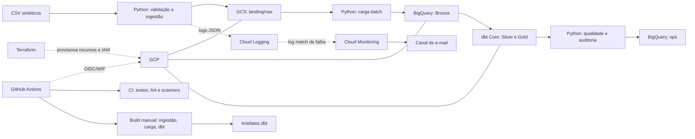

Python valida e carrega a Bronze; o dbt transforma Bronze em Silver e Gold,
mas não orquestra as demais etapas. O GitHub Actions coordena o build manual.
O Terraform configura recursos, IAM, política de alerta e canal de e-mail.
O diagrama detalhado e os limites por camada estão em
[docs/architecture.md](docs/architecture.md).

## Infraestrutura como código

Terraform provisiona o bucket, datasets, permissões e observabilidade. O
plano final foi revisado e não indicou mudanças pendentes:


## Dados sintéticos e ingestão

Os três arquivos de entrada contêm apenas clientes, contratos e parcelas
fictícios. O gerador usa seed fixa para tornar os exemplos reproduzíveis.

<p align="center">
  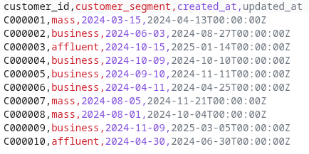
  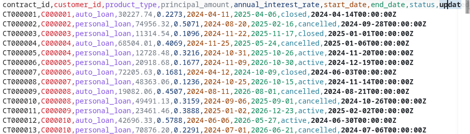
  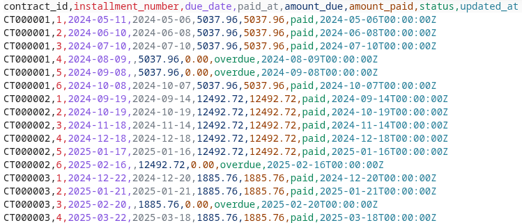
</p>

O pipeline preserva os objetos originais no prefixo `landing/`, particionados
por entidade e data de ingestão. A tela do bucket mostra a organização dos
objetos e uma captura de arquivo enviado:

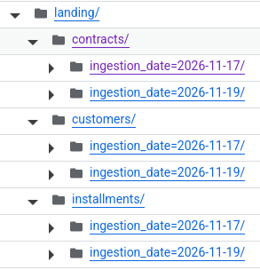

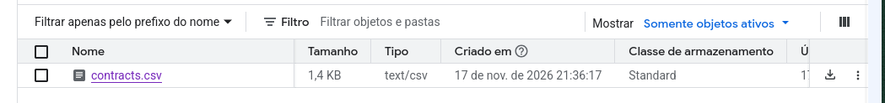

## Transformações e qualidade

O dbt Core transforma a Bronze em modelos incrementais Silver e tabelas Gold,
com testes e documentação de colunas. A captura de `silver_customers` vem do
`dbt docs` gerado para a execução registrada; o identificador do projeto foi
ocultado na relação da tabela.

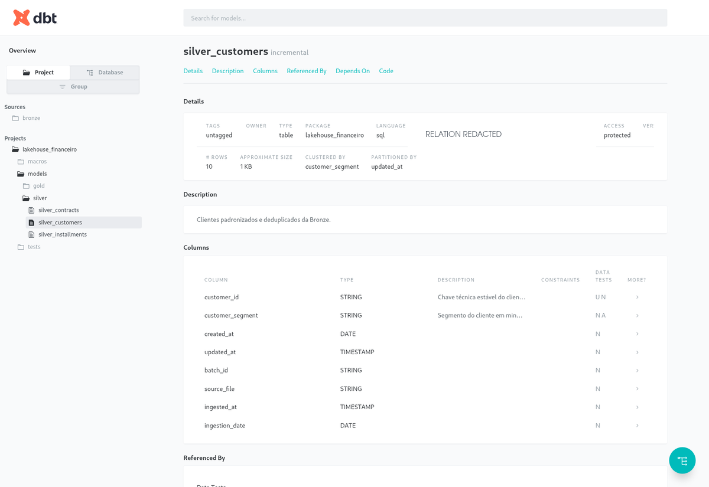

O módulo de qualidade grava contagens de entrada/saída e diferenças em
`ops.dq_results`. Este recorte mostra as métricas de contratos e clientes,
com entrada igual à saída e zero rejeições observadas:

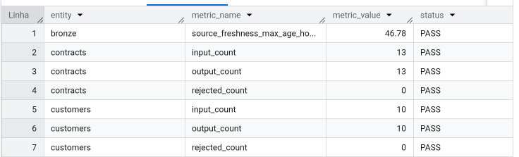

## CI/CD e alertas

O CI executa testes, compilação dbt, validação Terraform e scanner de segredos.
Esta execução registrada terminou com sucesso:

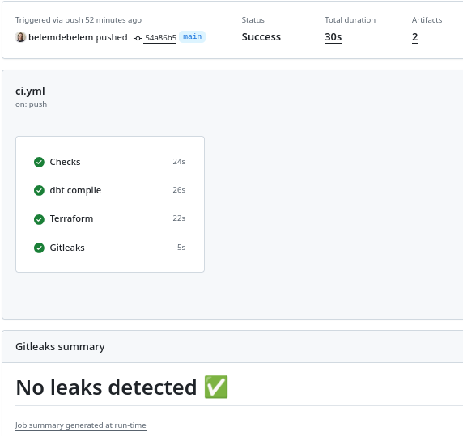

Uma política de Cloud Monitoring abre incidente quando chega um log que
corresponde ao filtro de falhas. A captura mostra a política configurada; o
alerta sintético abriu um incidente e a notificação por e-mail foi recebida.
O identificador do projeto foi ocultado na cópia do e-mail abaixo.

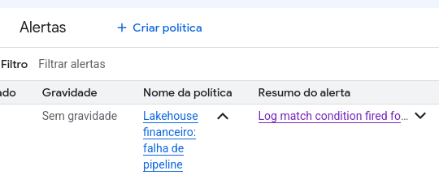

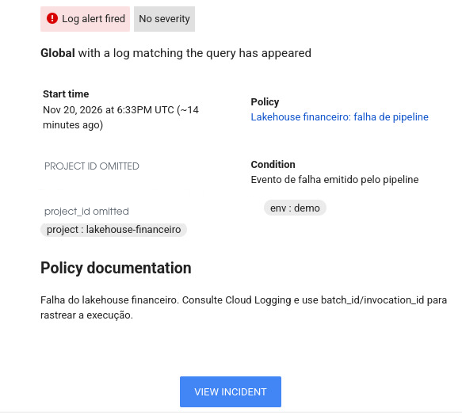

## Executar e reproduzir

Requisitos: Python 3.11 ou superior e `uv`.

```bash
uv sync --extra dev
uv run python -m lakehouse.generation
uv run pytest -q
uv run ruff check .
uv run sqlfluff lint dbt/models
```

A geração dos CSVs usa seed fixa e roda localmente, sem acesso à nuvem.
Para reproduzir o pipeline completo, configure ADC, `.env` e os recursos
GCP conforme [docs/dev/setup.md](docs/dev/setup.md). O fluxo de demonstração
validado usa `ingestion_date=2026-11-17`; a sequência e a falha recuperável
estão no [roteiro do runbook](docs/runbook.md#roteiro-de-demonstracao).

O build na nuvem pode ser iniciado em **Actions → DBT - Build controlado →
Run workflow**, informando a data de ingestão. O environment `demo` exige
aprovação. A execução também gera documentação e lineage dbt, anexados como
artefato `dbt-artifacts` por 14 dias. O artefato inclui `index.html`,
`catalog.json`, `manifest.json`, resultados, fontes e SQL compilado.

## Evidências e métricas observadas

| Evidência | Resultado observado | Origem |
|---|---:|---|
| CSVs válidos de entrada | 3 arquivos, 101 linhas, 7.712 bytes | `data/sample/` |
| Lote processado em 2026-11-17 | 10 clientes, 13 contratos, 78 parcelas; 0 rejeições observadas | `ops.ingestion_batches` e `ops.dq_results` |
| Build dbt registrado em 2026-11-19 | 83 resultados: 77 testes aprovados e 6 modelos executados; 115,3 s | `dbt/target/run_results.json` |
| Resumo de qualidade | 12 métricas `PASS`; contagens Bronze/Silver 10/10, 13/13 e 78/78 | validação de `ops.dq_results` |
| Alerta operacional | incidente de falha e notificação por e-mail recebida | validação sintética em 2026-11-20 |

As contagens e duração acima são uma fotografia das execuções documentadas,
não uma garantia de duração ou volume futuro. `rejected_count` mede a
diferença entre Bronze e Silver; não representa uma tabela de registros
rejeitados. O lote sintético tem zero diferenças observadas.

## Decisões e trade-offs

- **dbt Core:** SQL, incrementalidade, testes, contratos, documentação e
  lineage sem contratar dbt Cloud. O custo é manter as dependências travadas
  e os modelos/macros revisados. Consulte
  [ADR 0002](docs/decisions/0002-dbt-para-silver-e-gold.md).
- **GitHub Actions:** coordena o fluxo batch pequeno e manual, sem serviço
  sempre ligado ou taxa de orquestrador. Não oferece SLAs, backfills e retries
  sofisticados; reavalie se surgirem esses requisitos. Consulte
  [ADR 0003](docs/decisions/0003-orquestracao-github-actions.md).
- **BigQuery sob demanda:** evita reservas de slots; consultas e transformações
  ainda podem gerar cobrança por bytes processados.
- **GCS em São Paulo:** aproxima os dados do usuário, mas armazenamento nessa
  região é faturável; ciclo de vida remove objetos antigos após 30 dias.
- **Sem streaming, dashboard próprio ou serviços sempre ligados:** o escopo
  atual é batch demonstrativo com volumes pequenos.

### Custos

Não há um custo total fixo: GCS na região `southamerica-east1` é cobrado por
armazenamento e operações; BigQuery depende dos bytes processados; Cloud
Logging depende da ingestão mensal. A franquia publicada de Logging é 50 GiB
por projeto/mês. Uma política baseada em logs foi estimada em cerca de
US$ 0,035/mês pelo exemplo oficial de 100 políticas a US$ 3,50/mês. Esses
valores podem mudar e a franquia é compartilhada com outros recursos do
projeto. Consulte [preços do Cloud Storage](https://cloud.google.com/storage/pricing),
[BigQuery](https://cloud.google.com/bigquery/pricing) e
[Cloud Observability](https://cloud.google.com/products/observability/pricing)
antes de executar a demonstração.

Há um orçamento de billing baixo na conta, mas ele somente envia alertas e
não bloqueia cobranças. Execute sob demanda, acompanhe Billing Reports e
considere a remoção da infraestrutura ao terminar; veja
[limpeza e custo](infrastructure/terraform/README.md#limpeza-e-custo).

## Limitações e próximos passos

- Batch manual; sem agenda, streaming, SLA ou recuperação automática.
- Dados inteiramente sintéticos e volumes pequenos; métricas não representam
  uma operação financeira real.
- `rejected_count` é uma diferença Bronze/Silver e `store_failures` mantém o
  resultado mais recente de cada teste.
- O bucket e os datasets contêm dados de demonstração; destruição via Terraform
  remove conteúdo e exige aprovação explícita.
- Próximas evoluções devem partir de necessidade concreta: automatizar
  backfills/retries ou publicar artefatos estáticos de forma permanente. Não
  há dashboard próprio nem site dbt hospedado neste MVP.

## Documentação

- [Especificação e histórico de fases](docs/spec.md)
- [Arquitetura e diagrama detalhado](docs/architecture.md)
- [Setup, execução, CI/CD e limpeza](docs/dev/setup.md)
- [Runbook e demonstração](docs/runbook.md)
- [Dicionário de dados](docs/data-dictionary.md)
- [Decisões de arquitetura (ADRs)](docs/decisions/)
