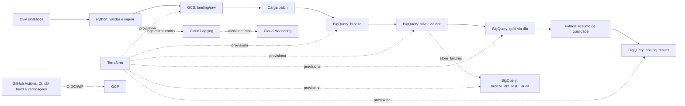

# Arquitetura do MVP

## Objetivo e escopo

Lakehouse batch para demonstrar ingestão, ELT, qualidade, segurança e
operação com dados inteiramente sintéticos. A execução é manual e usa
volumes pequenos. Não há streaming, serviço de computação sempre ligado
ou dado financeiro/pessoal real.

## Fluxo

## Camadas e responsabilidades

| Camada | Serviço | Conteúdo |
|---|---|---|
| Landing/Raw | GCS | CSV de origem preservados, identificados por entidade, data e lote. |
| Bronze | BigQuery | Linhas carregadas próximas à origem, com `batch_id`, `source_file` e `ingested_at`. |
| Silver | BigQuery + dbt | Tipos padronizados, deduplicação determinística, validações e contratos enforcement; diferenças de contagem resumidas em `ops.dq_results`. |
| Gold | BigQuery + dbt | Indicadores pequenos voltados às perguntas analíticas abaixo. |
| Transformação | dbt-core | Modelos SQL versionados, testes, contratos, docs e lineage. |
| Auditoria dbt | BigQuery | Resultados de falhas em `bronze_dbt_test__audit.*`, substituídos a cada execução do teste. |
| Operação | BigQuery `ops` | Estado de lote (`STARTED`, `SUCCEEDED`, `FAILED`) em `ops.ingestion_batches` e resumo por entidade/métrica em `ops.dq_results`. |

O pipeline Python valida arquivos, calcula checksum e identidade estável
do lote, envia arquivos ao GCS e dispara cargas batch na Bronze. O
dbt-core executa as transformações Silver e Gold com modelos
versionados, testes e lineage. O módulo de qualidade lê os artefatos do
dbt, conta linhas por entidade e grava o resumo em `ops`. A repetição do
mesmo arquivo mantém o mesmo `batch_id` e é idempotente.

## Carga Bronze

- Datasets, bucket e IAM são criados pelo Terraform; os schemas das
  tabelas Bronze e `ops` são definidos somente pelo SQL versionado em
  `sql/bronze/` e `sql/ops/`.
- O loader `src/lakehouse/loading.py` lê os metadados do objeto no GCS,
  valida `batch_id` e `ingestion_date`, grava o objeto em
  `<entidade>_staging` com schema explícito e `WRITE_TRUNCATE`, e aplica
  `MERGE` na tabela final pela chave de negócio.
- Cada entidade recebe `batch_id`, `source_file`, `ingested_at` e
  `ingestion_date`; as tabelas finais são particionadas por
  `ingestion_date` e clusterizadas pelos campos de filtro mais usados.
- `ops.ingestion_batches` registra `STARTED` antes da carga e
  `SUCCEEDED` ou `FAILED` ao final. Se o lote já estiver `SUCCEEDED`, a
  carga é ignorada; isso evita duplicatas sem exigir transação
  distribuída.
- A carga é manual e usa somente os três CSVs pequenos da Fase 4.

## Transformações com dbt

- dbt-core `1.12.6` + dbt-bigquery `1.12.3` processam Silver e Gold; a
  Bronze é carregada pelo Python. As versões são fixadas juntas no
  `pyproject.toml` e no `uv.lock`; não há dbt packages externos.
- `sources.yml` aponta para `bronze.customers`, `bronze.contracts` e
  `bronze.installments`.
- Modelos Silver são incrementais com `merge`, `unique_key`, partição por
  `updated_at`, clustering, janela de segurança de 3 dias e deduplicação
  por `updated_at`, `ingested_at` e `source_file`. Contratos são
  enforcement na Silver; modelos Gold usam `table` sem contrato
  enforcement nesta fase.
- `generate_schema_name` isola `dev` em `silver_dev`/`gold_dev`; a exceção
  para schemas de teste terminados em `_dbt_test__audit` mantém o nome
  `bronze_dbt_test__audit` sem sufixo. Somente o target `prod` grava em
  `silver`/`gold`. Terraform cria os datasets de desenvolvimento e de
  auditoria e concede `roles/bigquery.dataEditor` à conta de serviço
  `lakehouse-dbt`.
- A data de referência analítica é `2026-01-31`.
  `mart_carteira_credito` usa principal original de contratos
  `active`/`closed` com cobertura no fim do mês;
  `mart_inadimplencia` agrupa parcelas vencidas e não pagas até a data de
  referência; `fato_pagamentos` consolida parcelas pagas.
- Testes genéricos e singulares cobrem chaves, domínios, datas, valores e
  relacionamentos. `store_failures` persiste falhas em
  `bronze_dbt_test__audit`; `dbt source freshness` valida a Bronze com
  limites de 72h/168h; `ops.dq_results` resume contagens, testes e
  freshness por data de ingestão.
- `dbt docs generate` gera catálogo e lineage locais em `dbt/target/`.
- `profiles.yml` não contém segredos; usa `env_var`, ADC local e WIF/ADC
  no GitHub Actions.
- dbt não orquestra: o pipeline Python e o GitHub Actions controlam a
  ordem ingestão → Bronze → `dbt build`.
- dbt Cloud, Semantic Layer e Mesh ficam fora do MVP.

## Perguntas analíticas do MVP

1. Qual o valor original de contratos ativos no fechamento de cada mês,
   por produto? Para manter a regra simples e explícita, isso será uma
   aproximação baseada no principal original e nas datas/status do
   contrato, não um cálculo de saldo amortizado.
2. Quantas parcelas estão vencidas e não pagas, qual o valor em atraso e
   como isso varia por mês e produto?
3. Como o valor pago e a quantidade de parcelas pagas variam ao longo do
   tempo?

## Dados de entrada

- CSV UTF-8, cabeçalhos em `snake_case`, separador vírgula, datas ISO
  `YYYY-MM-DD` e decimais com ponto.
- Um arquivo por entidade e lote. Os arquivos de demonstração são
  pequenos e gerados localmente com seed fixa.
- Entidades: clientes fictícios, contratos e parcelas/pagamentos.
- Não gerar CPF, nome, endereço, conta bancária, credenciais ou valores
  obtidos de operações reais.

## Recursos GCP implantados

- Projeto GCP dedicado ao portfólio, com faturamento já associado; o
  `project_id` é fornecido pelo ambiente local e pelo `terraform.tfvars`.
- Região proposta: `southamerica-east1` (São Paulo), usando a mesma
  localização para o bucket e os datasets para reduzir transferências
  entre regiões e manter os dados perto do usuário.
- Um bucket regional GCS Standard para Landing/Raw, acesso uniforme,
  prevenção de acesso público e limpeza curta dos dados de demonstração.
  Versionamento de objetos fica desligado; a aplicação evita
  sobrescritas com precondição de geração.
- Datasets BigQuery `bronze`, `bronze_dbt_test__audit`, `silver`,
  `silver_dev`, `gold`, `gold_dev` e `ops` na região do bucket. Os datasets
  `*_dev` isolam execuções dbt de desenvolvimento; o dataset de auditoria
  separa falhas de testes dos dados de negócio. A conta `lakehouse-dbt`
  também tem `dataEditor` no dataset de auditoria. Cargas batch; consultas
  sob demanda com limite de bytes processados; sem reservas de slots.
- dbt-core roda localmente e no GitHub Actions; não há serviço GCP
  adicional nem custo de licença. O custo é o tempo de CI e os bytes
  processados no BigQuery.
- Cloud Logging para logs estruturados do pipeline, com baixo volume e
  retenção padrão.
- Cloud Monitoring para métricas nativas e um alerta simples de falha
  baseado em logs. Sem uptime checks, dashboards amplos ou métricas
  customizadas de alta cardinalidade no MVP.
- IAM com menor privilégio. ADC na execução local; Workload Identity
  Federation para GitHub Actions já versionado, com principal limitado ao
  repositório e três contas de serviço: CI/deploy, pipeline e dbt. Nenhuma
  chave JSON de service account no repositório.
- O CI usa WIF apenas para `dbt compile` em PRs do mesmo repositório; PRs
  de forks executam testes, lint, SQLFluff, `dbt parse`, Terraform e
  scanners sem credenciais GCP.
- O CD separa `plan` de `apply`; `apply` e o build dbt exigem o environment
  `demo` com aprovação humana. Variáveis do repositório substituem segredos
  estáticos.
- Secret Manager permanece disponível para um segredo real caso surja
  essa necessidade. ADC/WIF evitam criar segredo estático para a
  autenticação normal do MVP; não criar segredo de demonstração fictício.
- Terraform para os recursos. O CD gera o backend GCS, reaproveitando o
  bucket do lakehouse com prefixo dedicado, sem novo bucket de state. A
  migração do state local e o `apply` do WIF ainda dependem de autorização
  explícita.

## Controles de custo

- Orçamento mensal sugerido: menor valor aceito pela Console, usando
  equivalente a US$ 1 como referência, com alertas em 50%, 90% e 100%.
  Esse orçamento alerta; não interrompe o consumo.
- Execuções manuais, poucos CSVs sintéticos e sem recursos ociosos.
- Manter GCS e BigQuery na mesma região. Não usar streaming, Dataflow,
  Cloud Run, VMs, Scheduler ou reservas de slots no MVP.
- Revisar Billing após a demonstração e remover dados/recursos que não
  precisam permanecer.
- Estimativa de planejamento: aproximadamente US$ 0,01–0,10 por mês para
  armazenamento/uso pequeno em São Paulo, supondo até 1 GiB no GCS,
  consultas e logs muito abaixo das franquias gratuitas e sem state
  remoto adicional. O valor final depende de volume, região, franquias
  compartilhadas na conta, câmbio e impostos.

## Segurança, logging e monitoramento

- Gitleaks verifica segredos no pre-commit e no CI; Checkov verifica
  Terraform no CI; SQLFluff valida os modelos dbt; IAM reduz permissões;
  ADC/WIF evitam chaves duradouras.
- O `profiles.yml` do dbt não contém segredos e usa ADC/WIF; os artefatos
  do dbt não incluem credenciais.
- Cada log de pipeline inclui `pipeline_name`, `batch_id`, `source_file`,
  `stage`, `status`, timestamps e contagens disponíveis. Mensagens não
  incluem credenciais nem dados sensíveis.
- Cloud Logging recebe os logs explicitamente; scripts locais e GitHub
  Actions não enviam logs automaticamente.
- Cloud Monitoring usa métricas nativas do BigQuery/GCP e um alerta de
  falha baseado em logs. Métricas customizadas só serão adicionadas se
  forem necessárias e após avaliar custo/cardinalidade.

## Fora do MVP

Streaming, Dataflow/Beam, Pub/Sub, Composer, Scheduler/Workflows,
Dataplex, dbt Cloud/Semantic Layer/Mesh, dashboard próprio, Kubernetes,
APIs bancárias reais e dados pessoais reais.

## Decisões relacionadas

- [ADR 0001 — Arquitetura MVP, segurança e custo](decisions/0001-arquitetura-mvp-e-custos.md)
- [ADR 0002 — dbt-core para Silver e Gold](decisions/0002-dbt-para-silver-e-gold.md)
- [ADR 0003 — GitHub Actions como orquestrador do MVP](decisions/0003-orquestracao-github-actions.md)
- [ADR 0004 — Segurança automatizada mínima](decisions/0004-seguranca-automatizada-minima.md)
- [ADR 0005 — State local do Terraform no MVP](decisions/0005-estado-local-terraform.md)
- [ADR 0006 — Carga Bronze idempotente](decisions/0006-carga-bronze-idempotente.md)
- [ADR 0007 — Modelagem dbt Silver e Gold com isolamento por target](decisions/0007-modelagem-dbt-silver-gold.md)
- [ADR 0008 — Qualidade, auditoria de testes e recuperação](decisions/0008-qualidade-auditoria-recuperacao.md)
